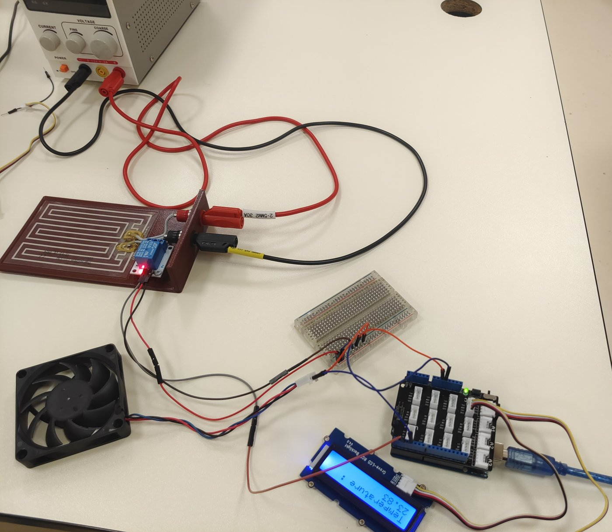
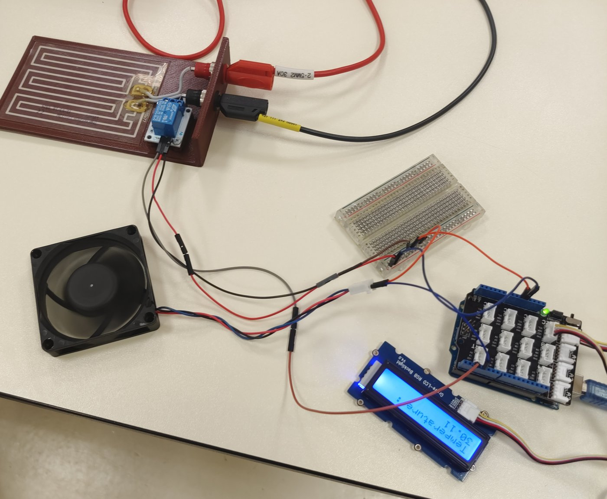
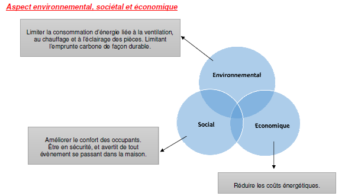
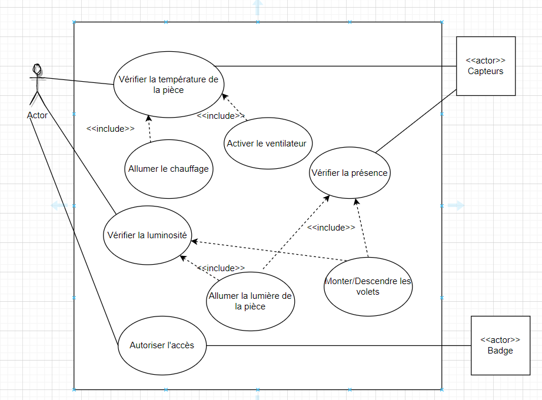
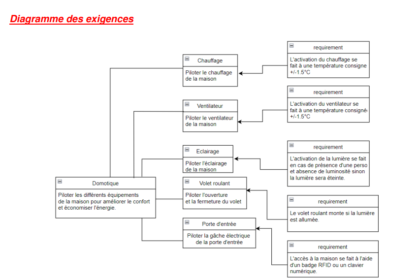
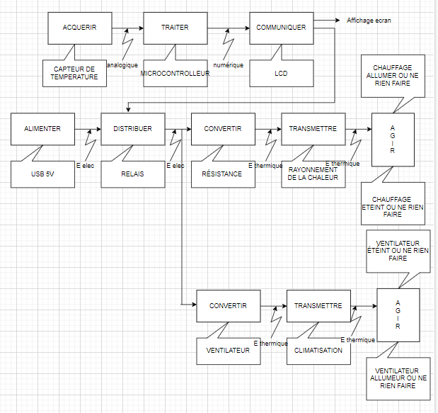
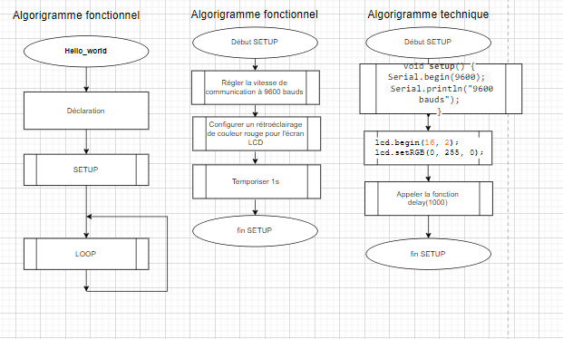
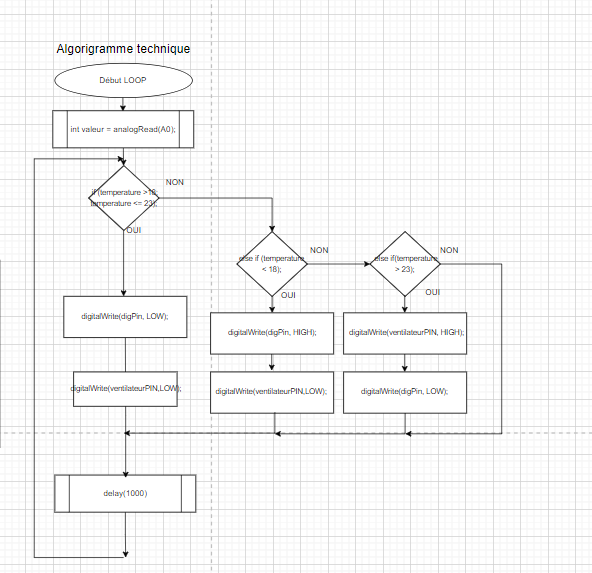

# Maison connectée : régulation de la température

🇫🇷 [Français](#français) · 🇬🇧 [English](#english)

**Essayer la démo :** https://valentin-auger-laboratoire.github.io/portfolio/demos/maison-connectee/

---

## Français

### Le projet
Projet de **terminale STI2D, option SIN** (novembre 2022). Dans le projet « maison connectée », ma tâche était la tâche 1 : *comment anticiper le fonctionnement du chauffage ou du ventilateur en fonction de la température ?*

On régule la température d'une pièce avec :
- un capteur Grove (thermistance) sur A0 ;
- une résistance chauffante commandée par un relais ;
- un ventilateur ;
- un écran LCD qui affiche la température.

J'ai fait seul ma partie du projet :
- l'analyse du besoin et les diagrammes SysML (sous draw.io) ;
- les chaînes d'information et de puissance ;
- les algorigrammes ;
- le programme Arduino commenté ;
- le montage et les tests.

| Mon montage à 23,83 °C : le relais du chauffage est allumé | À 30,11 °C : le relais est éteint |
|---|---|
|  |  |

### Analyse et conception
| Enjeux | Cas d'utilisation | Exigences |
|---|---|---|
|  |  |  |

| Chaînes d'information et de puissance | Algorigramme fonctionnel | Algorigramme technique |
|---|---|---|
|  |  |  |

### Le programme (`code/`)
Les programmes sont **transcrits** depuis les captures de ma présentation (`images/code-*.png`).
- `maison_2022_televersee.ino` : la version téléversée, avec ses seuils :
  - chauffage allumé si T ≤ 26 °C ;
  - tout éteint entre 26,1 et 29,9 °C ;
  - ventilateur allumé si T > 30 °C.
- `maison_2022_premiere_version_extrait.ino` : le début de la première version, avec des seuils à 27 et 30 °C.
- `maison_2026.ino` : la version corrigée en 2026, **non testée sur le montage**, qui n'existe plus.

Broches : le relais du chauffage est sur D2 (`digPin`), le ventilateur sur D4 (`relayPin`). Mes deux photos le confirment : la LED du relais est allumée à 23,83 °C et éteinte à 30,11 °C.

### Vérification en 2026
1. **Le relais claque.** Les seuils sont collés : de 26 à 26,1 °C, puis de 29,9 à 30 °C. La mesure varie d'environ 0,08 °C par point du convertisseur. Avec un peu de bruit, le chauffage s'allume et s'éteint toutes les quelques secondes. Sur une journée d'hiver simulée, on compte environ 3 000 commutations. Avec une hystérésis de 1 °C, il en reste moins de 100.
2. **Sonde débranchée = chauffage allumé.** Si le capteur est débranché (0) ou en court-circuit (1023), la formule donne −273,15 °C. C'est inférieur à 26, donc le chauffage reste allumé. Correction : détecter le défaut et tout couper.
3. **Des noms qui trompent.** `relayPin` (D4) commande le ventilateur, alors que le relais est sur `digPin` (D2), avec le chauffage. Un commentaire dit « le ventilateur s'allume » là où c'est le chauffage. La déclaration de `digPin` porte, elle, le commentaire de la constante B. Le câblage était bon, seuls les noms et les commentaires trompent.
4. **Les commentaires ne suivent plus les seuils.** On lit « T supérieur 25, T inférieur ou égal 27 » pour un test entre 26,1 et 29,9 °C.
5. **Une boucle lente et bloquante.** delay(100) + delay(1000) + delay(1000), soit 2,1 s par tour. `analogRead(A0)` est lu deux fois et `Serial.begin` est appelé deux fois.
6. **L'écran garde des restes.** La ligne 2 n'est jamais effacée : après « -273.15 », afficher « 26.43 » laisse « 26.4315 ».
7. **Un débordement qui tombe juste.** Sur un Arduino Uno, un `int` tient sur 16 bits, au maximum 32 767. `const int R0 = 100000` devient donc −31 072. La température reste juste, parce que R0 se simplifie dans R/R0.

### La démo (`demo/`)
- Les deux programmes tournent côte à côte sur la même journée simulée : hiver, mi-saison, été, sonde débranchée, sans bruit.
- On y voit l'écran LCD, les moniteurs série et le chronogramme des sorties.
- **La pièce est une maquette thermique supposée,** qui sert seulement à comparer les deux programmes : capacité 4 000 J/K, pertes 1 W/K, chauffage 20 W, ventilateur +3 W/K, bruit de ±1 point.

```bash
node demo/tests/test.js   # 62 tests
```

---

## English

### The project
**Final-year STI2D project, digital systems option** (November 2022). My part, task 1, was to regulate a room's temperature with:
- a Grove thermistor;
- a heater driven by a relay;
- a fan;
- an LCD screen.

I did my part on my own: SysML diagrams (draw.io), information and power chains, flowcharts, the commented Arduino program, wiring and tests.

### Program
- `code/` holds the uploaded 2022 program (thresholds 26 / 26.1 / 29.9 / 30 °C), **transcribed** from my presentation screenshots, and a 2026 corrected version (not tested on the original circuit).
- My photos confirm the wiring: the relay (heater) is on D2, the fan on D4.

### 2026 review
- **Chattering relay:** the thresholds are only 0.1 °C apart.
- **Unplugged sensor:** it reads −273.15 °C, so the heater turns on.
- **Misleading names and comments.**
- **Blocking delay() calls** and a double analogRead.
- **LCD leftovers:** line 2 is never cleared.
- **A 16-bit int overflow (R0)** that happens to cancel out.

### Demo
- Both programs run side by side on a simulated day.
- The room is an assumed thermal model.
- 62 tests.

---

← [Portfolio](https://valentin-auger-laboratoire.github.io/portfolio/#projets)
